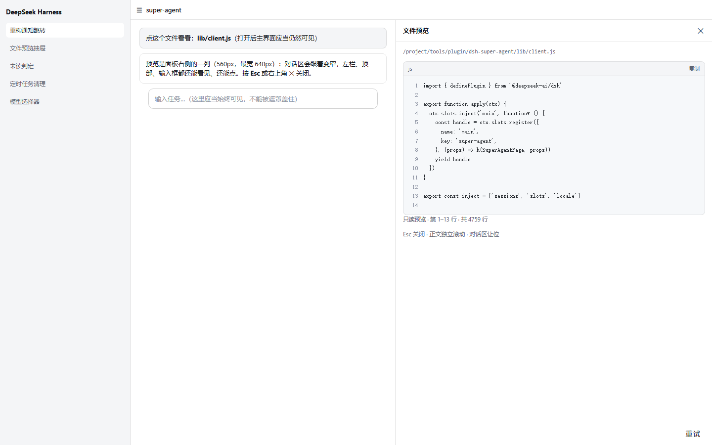
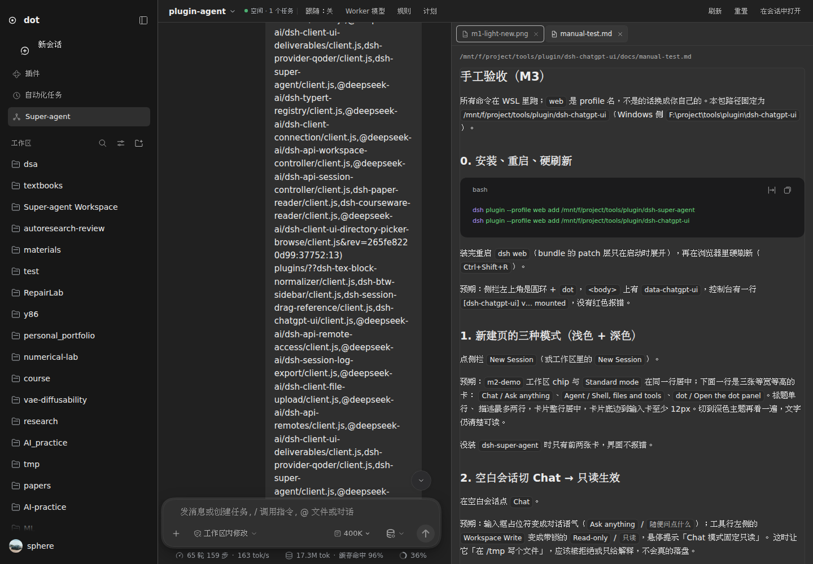

# dsh-super-agent

DeepSeek Harness 的 **Super-agent 控制面**：自然语言入口 + Router/Worker 双层调度 +
多实例 Web 面板。Router 负责判断与分派，Worker 负责执行；面板复用 DSH 官方会话，
不是另一套聊天 UI。

## 安装

```sh
dsh plugin --profile web add /abs/path/to/dsh-super-agent
```

重启 `dsh web`，硬刷新页面，点击左栏 **Super-agent**。首次打开会自动准备独立的
Super-agent Workspace，不需要先选项目。

可选：在项目根放 `.dsh/super-agent.json`（至少 `{"version":1,"enabled":true}`）让该
项目的根会话成为 Router 并拿到工具；字段见 [使用与配置](docs/usage.md#配置文件)。

## 快速开始

1. 打开左栏 Super-agent 面板（左上角可切换/新建实例）。
2. 直接输入任务；Router 通过 `superagent_projects` 选项目并派 Worker。
3. 右侧「近期活动」看状态、报告、线程，给在线 Worker 补指令或打开完整会话。
4. 任务完成的通知点一下，回到产生它的实例和会话。

## 关键功能

- **双层调度**：同项目用 subagent，跨项目在目标项目建普通 Session，沙箱正确。
- **多实例**：每实例独立目录、模型、规则、计划、未读；侧栏仍只有一个入口。
- **Worker 复用**：Thread 后续直接投递到原 Worker；独立任务并行。
- **模型可控**：默认跟随宿主全部模型；可维护 allowlist、默认模型/effort。
- **长期约定**：全局/项目规则注入 Router 和每个 Worker，Reset 不丢。
- **定时唤醒**：一次/每日/每周/Cron，到点唤醒 Router 再决定是否派活。
- **原生目标**：目标 + 里程碑 + 检查节奏；创建/更新不唤醒，不自动续轮。
- **事件与审计**：Trigger 队列合批；journal 只追加；Worker 会话不进侧栏。
- **通知**：任务完成弹系统通知（需 `dsh-away-notify`），点击落回面板对应实例/会话。
- **输入区徽标**：`运行中 N / 未读 M`，无任务自动消失，点击回面板。

## 可选联动

- **dsh-chatgpt-ui**：装了它，dot 模式可选中本面板；没装不影响本插件任何功能。
- **dsh-away-notify**：提供系统通知与点击回跳；没装时不弹通知，内部 worker 退回标题
  前缀标记，其它功能照常。
- 本插件不依赖其它插件的皮肤、service、slot 或配置；反向也不要求对方存在。

## 截图




## 文档

- [使用与配置](docs/usage.md) · [架构与设计](docs/design.md)
- [开发](docs/development.md) · [测试](docs/testing.md) · [排障](docs/troubleshooting.md)
- [变更记录](CHANGELOG.md)
