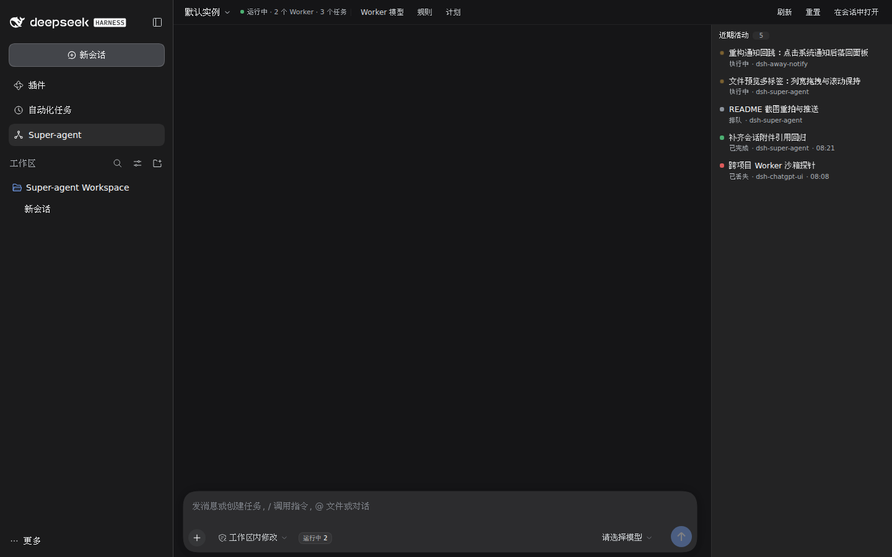
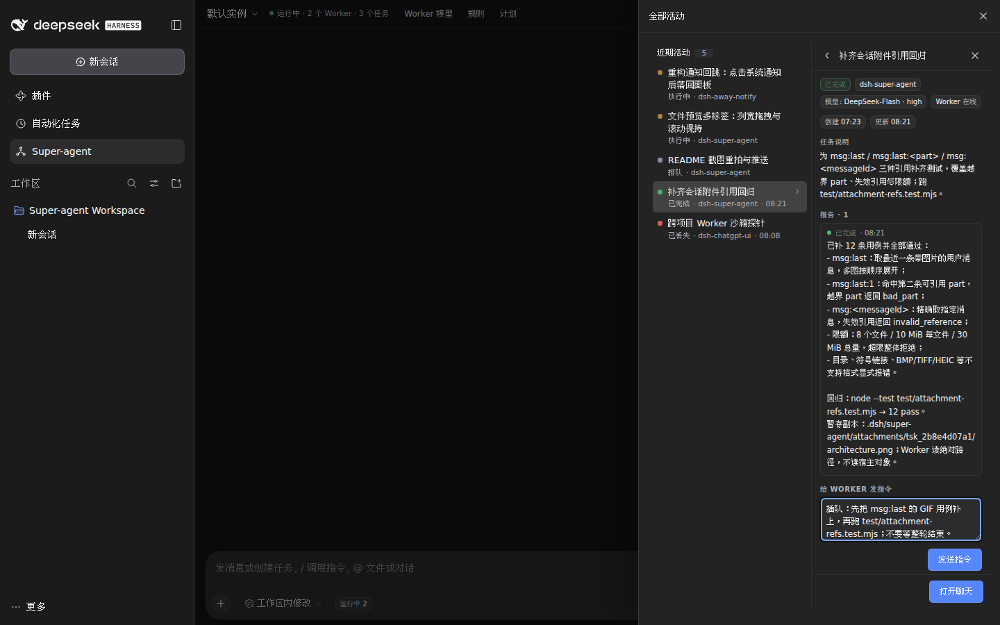
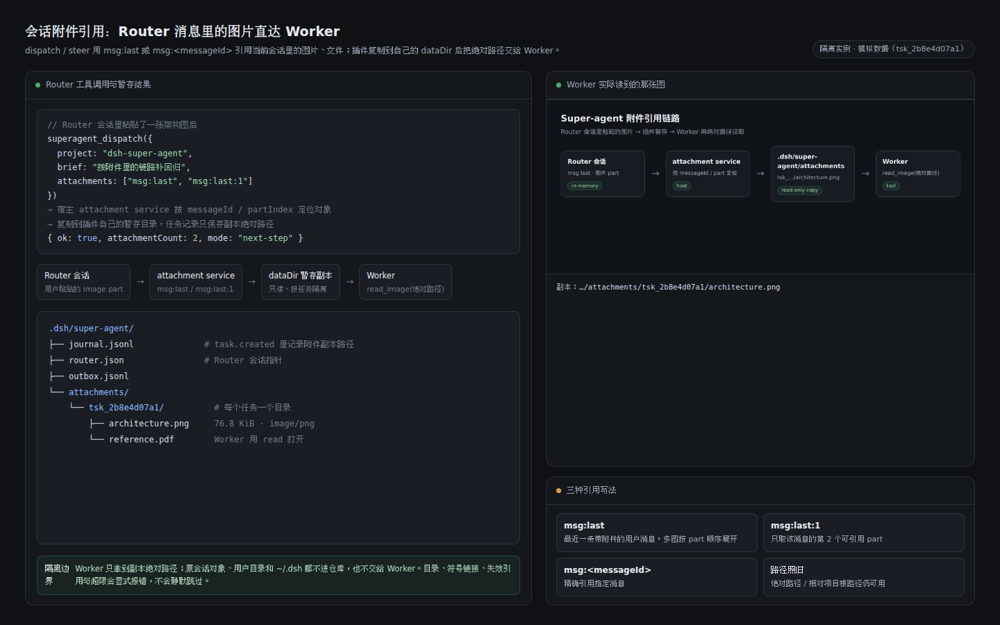

# dsh-super-agent

DeepSeek Harness 的 **Super-agent 控制面**：Router 负责判断与分派，Worker 负责执行，
面板复用 DSH 官方会话，不是另一套聊天 UI。

## 亮点

- **插队 steer**：给在线 Worker 补指令默认投到当前 run 的**下一个模型步**（正在执行的
  工具先安全结束），不用等整轮；`interrupt:false` / `mode:"queue"` 才排队到下一轮。
  回执和 journal 的 `task.steered` 记录实际模式；旧宿主没有 `steer()` 时自动退回排队并
  给出 `warning`。
- **会话附件引用**：`superagent_dispatch` / `superagent_steer` 的 `attachments` 除了
  绝对/相对路径，还可写 `msg:last`、`msg:last:<partIndex>`、`msg:<messageId>`、
  `msg:<messageId>:<partIndex>`，直接从当前 Router 会话取用户粘贴或上传的图片、文件。
  插件通过宿主 attachment service 定位对象，复制到 `<dataDir>/attachments/<taskId>/`，
  Worker 拿到副本绝对路径（图片用 `read_image`）。
- **任务与丢失判定**：`lost` / `interrupted` 不再计入「进行中」；`active`、`lost` 由
  `lib/task-counts.js` 一处派生，status、面板徽标、Router 提示词共用同一口径。`starting`
  在 `startTimeoutMs` 内不会被误判 lost，`workerSessionId` 等宿主返回 canonical id 后才
  登记；`working` / `blocked-approval` 掉线要二次探测并过 `lostGraceMs`（默认 10s）宽限
  才落 lost。
- **与 dsh-chatgpt-ui 的 dot 品牌位适配**：装了它，dot 分段只在检测到 `main` 槽的
  `super-agent` 面板时出现，点一下切到本面板；本插件不依赖它的类名、令牌或配置，没装
  也不影响任何功能。

面板、工具、模型 allowlist、长期约定、定时唤醒、原生目标、审批阻塞与多实例仍在；
细节见 [使用、配置与 HTTP API](docs/usage.md)。

## 安装启用

```sh
dsh plugin --profile web add /abs/path/to/dsh-super-agent
```

重启 `dsh web` → 硬刷新页面 → 左栏 **Super-agent**。首次打开会自动准备独立的
Super-agent Workspace，不需要先选项目。项目要启用时，在项目根放
`.dsh/super-agent.json`（最小 `{"version":1,"enabled":true}`）；没有文件默认关闭，
字段见 [配置文件](docs/usage.md#配置文件)。

从系统通知回到本插件时直接落到对应实例与会话，成功定位不再多弹一条提示；只有认不出
会话或切换实例失败时才提示。

宿主兼容 DSH 0.2.1 与 0.2.2（含 rc）：`subagents.startActivation` 的 activation spec
同时提供 0.2.2 的扁平字段和 0.2.1 的 `request` 别名；`ctx.schedule` 由
`lib/schedule-bridge.js` 同时适配 0.2.1 的按会话 API 与 0.2.2 的宿主级 API
（typed `timing`、分页 `list`、`edit` 删除）。同一份代码两代宿主都能派工与定时唤醒。

## 截图

任务列表：两条执行中、一条排队、一条已完成、一条已丢失；顶部「运行中 · 2 个 Worker ·
3 个任务」不包含已丢失。



Worker 报告与给 Worker 补指令；发送默认插队到当前 run 的下一个模型步。



会话附件引用：从 Router 会话取 `msg:last`，复制到 dataDir 的 attachments 目录，再把
绝对路径交给 Worker。



## 文档

- [架构与设计](docs/design.md) · [测试与回归矩阵](docs/testing.md)
- [使用、配置与 HTTP API](docs/usage.md) · [审批阻塞](docs/approval.md)
- [排障](docs/troubleshooting.md) · [变更记录](CHANGELOG.md)

## 已知限制

- 单机、单进程；状态在 dataDir 的追加式 journal 里，不删除、不轮转。同一 dataDir 只允许
  一个 Router（租约），多开 DSH 实例请用各自的实例目录。
- Worker 会话不跨 `dsh web` 重启恢复：能救回的转 `resumable`，救不回的转
  `interrupted`；被打断的那一轮不会重放，需要 Router 决定续跑、复用还是关闭。
- 跨项目 Worker 使用普通 Session，审批走目标项目的默认策略；本插件不自动放行。
- 附件引用只解析当前 Router 会话里的消息；暂存副本留在 dataDir，不自动清理。失效引用、
  越界 part、目录/符号链接和不支持格式都会显式报错。
- 不内置 IM/GitHub API，频道桥只读 outbox；没有 dsh-away-notify 时没有系统通知，
  Worker 退回标题前缀标记，其它功能照常。
