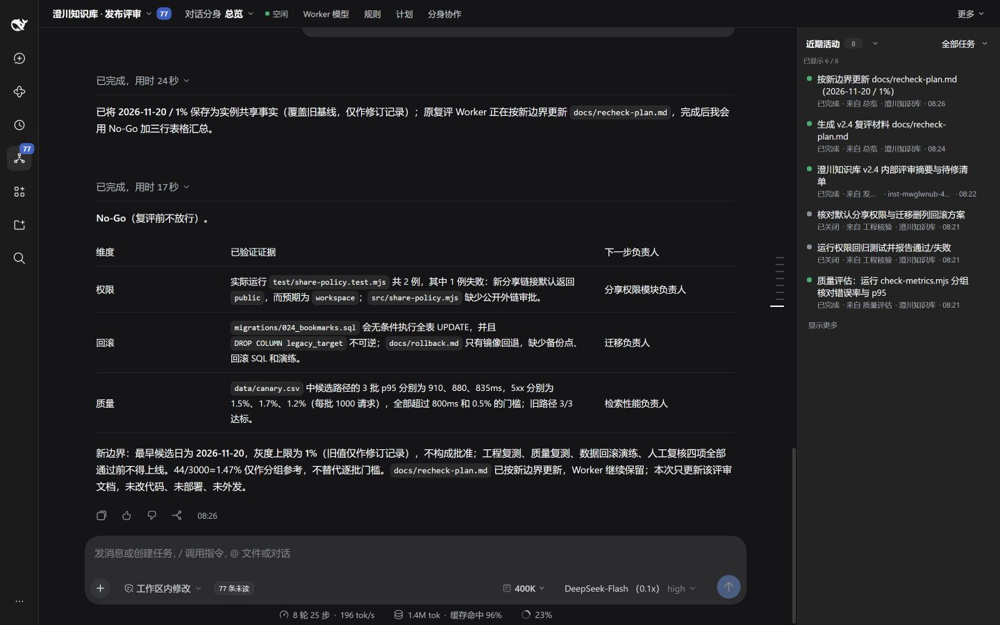
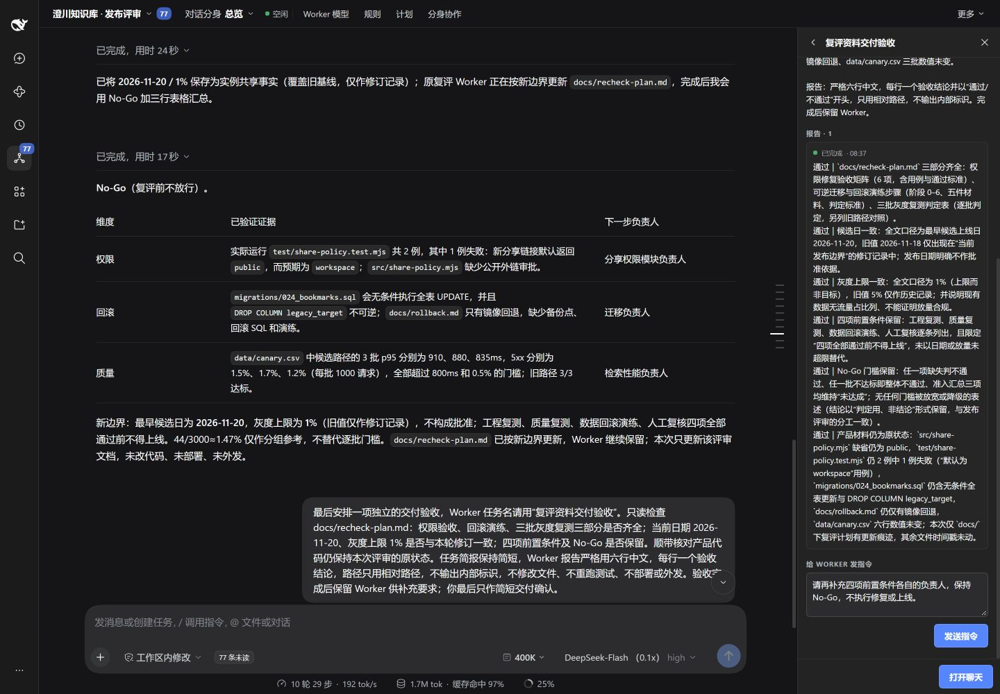
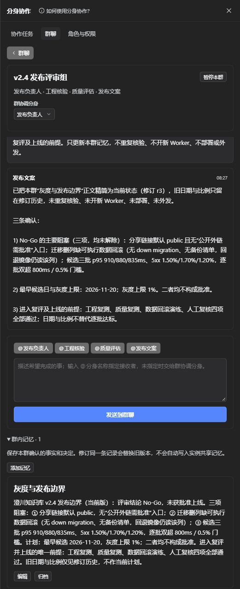
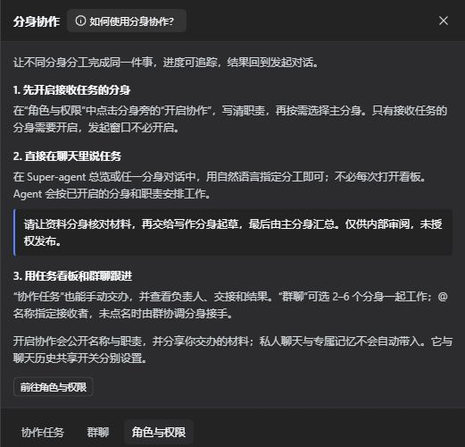
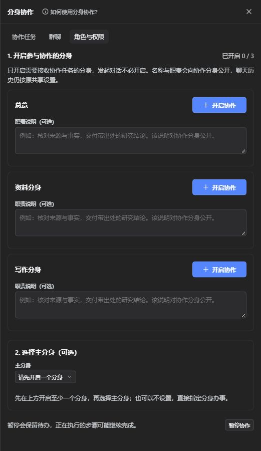

# dsh-super-agent

在 DSH 中持续推进复杂任务：你描述目标，Super-agent 判断下一步、拆分工作，调度独立
Worker 并行执行，汇总报告后继续跟进。统一看板提供任务进度、审批、补充指令和定时唤醒，
聊天与执行会话复用 DSH 原生界面。

对话分身是可选扩展：需要按工作方向分开聊天时，再创建独立历史与记忆；开启协作后，
可交办、交接任务或建立小组，共用同一实例的任务资源。



## 安装

```bash
dsh plugin --profile web add github:TianzeLuo/dsh-super-agent
```

1. 重启 `dsh web`（首次安装或替换包必须重启）
2. 刷新页面，左栏出现 **Super-agent**

开发调试时可改装本地目录：`dsh plugin --profile web add /path/to/dsh-super-agent`。

装不上或装完没反应，看 [排障](docs/troubleshooting.md)。

## 兼容性

| 项 | 值 |
| --- | --- |
| DSH | `>=0.2.1`（只写下界） |
| 验证于 | 0.2.2-rc.3（2026-11-14 UTC，见[兼容记录](docs/compat-matrix.md)） |
| Node | `>=22.5` |
| 平台 | web profile；Windows / WSL2 已验证 |

## 能做什么

- **两层代理**：Router 判断、Worker 执行，长任务不阻塞对话；面板复用官方会话，消息、审批和平时一致。
- **任务看板与定时唤醒**：进行中 / 已丢失 / 等待审批分得清；到点自动唤醒 Router 继续。
- **插队 steer**：给在线 Worker 补一句话，默认在它的下一个模型步生效，不必等整轮跑完。
- **会话附件引用**：当前 Router 会话里粘贴或上传的图片、文件可直接交给 Worker，不用先另存。
- **默认 Worker 模型集合**：在模型面板勾选后「设为默认」，新实例和新会话继承，不再默认全选。
- **可更新的记忆**：修订同一事实、归档过时信息；完整条目按重点与相关性注入，预算不足时明确提示并按需读取。
- **可选的对话分身**：按研究、写作、日常等方向分开聊天与记忆，共用任务资源；按需分享摘要或查阅聊天。
- **可选的分身协作**：按需开启角色与主分身，交办、交接任务或建立小组群聊；协作上下文单独保存，结果返回原处。

## 一个完整的项目场景

以“澄川知识库 v2.4 发布评审”为例：工程侧运行权限回归并检查迁移回滚，质量侧分析
候选与旧路径的三批灰度指标，Super-agent 汇总证据并继续准备复评材料。截图来自隔离
实例的实际执行，项目和输入数据均为虚构示例，模型固定为 Qoder 的 dfmodel。

**任务总览（页首）：** 统一跟进核验任务与结果。此例发现默认分享权限错误、数据回滚
缺口及灰度指标超限，得到 No-Go，候选日期不构成上线批准。

**Worker 报告与后续要求：** 查看执行证据，继续补充复评要求，保留可追踪的交付物。
图中的交付文档验收通过，项目仍为 No-Go，须完成整改与复评。



**可选的分身协作：** 质量分身将证据交接给文案分身；群聊中把最早候选日由 11 月 18 日
改为 11 月 20 日，灰度上限由 5% 收紧到 1%，同时保留复测、回滚演练和人工复核条件。
变更分别保存到主对话的实例共享记忆与评审群的群内记忆。



## 用法

| 触发方式 | 位置 | 行为 |
| --- | --- | --- |
| 左栏 **Super-agent** | 侧栏 | 打开面板；首次使用自动准备独立的 Super-agent Workspace |
| 直接说话派活 | Router 对话 | Router 自行决定开 Worker 还是直接回答 |
| **对话分身 · 当前名称** | 顶栏 | 展开或收起分身切换栏；收起后仍能看清当前在和哪个分身聊天 |
| **新建分身 / 管理与记忆** | 展开后的分身栏 | 创建并切换独立对话，管理共享、协作摘要、记忆和 AI 参考内容 |
| **分身协作** | 顶栏 | 查看使用帮助，开启接收任务的分身，按需设置主分身或建立群聊 |
| **任务范围** | 近期活动 | 切换本分身任务或全部任务，并查看任务来自哪个分身 |
| 项目开关 | 项目根 `.dsh/super-agent.json` | 写入 `{"version":1,"enabled":true}` 才启用；没有文件默认关闭 |
| 任务徽标 / 报告 | 面板 | 查看状态、补指令（steer）、处理审批 |

关掉插件后：面板与 Worker 入口消失，普通会话和其他插件照常；项目配置与 journal 保留。

### 第一次使用分身协作

1. 在顶栏展开 **对话分身**，新建所需分身，例如“资料分身”和“写作分身”。
2. 打开 **分身协作 → 角色与权限**，先点击各接收分身的 **开启协作**，再按需填写职责、选择主分身。主分身可不设，发起对话的分身也不必开启接收。
3. 回到 Super-agent 总览或任一分身聊天，用自然语言描述分工，例如：“请让资料分身核对材料，再交给写作分身起草，最后汇总给我。仅供内部审阅，未授权发布。”
4. 在 **协作任务** 查看负责人、进度和交接；也可手动交办，或建立 2–6 个分身的 **群聊**，用 `@分身名称` 指定接收者，未点名时由群协调分身接手。

标题旁的 **如何使用分身协作？** 随时可打开说明。开启协作会公开名称、职责及明确交办的材料；私人聊天与专属记忆不会自动共享，历史共享仍由原有开关控制。

<details>
<summary>查看协作帮助与首次设置截图</summary>

以下为隔离演示实例中的实际界面，内容均为示例。





</details>

配置项、工具参数与 HTTP 接口见 [使用与配置](docs/usage.md)；记忆取舍与测试结果见
[记忆设计](docs/memory-design.md)和[场景验证](docs/memory-evaluation.md)。
界面编排与常见操作见[交互设计](docs/ui-design.md)。
主从协调、交接、群聊和权限边界见[分身协作](docs/collaboration.md)。

## 已知限制

- 单机单进程；状态在 dataDir 的追加式 journal 里，不轮转。同一 dataDir 只有一个 Router 运行时，主题会话共用它。
- Worker 会话不跨 `dsh web` 重启恢复：能救回的转为可续跑，救不回的标记为中断，由 Router 决定下一步。
- 未装 [dsh-away-notify](https://github.com/TianzeLuo/dsh-away-notify) 时没有系统通知，只退回标题前缀标记。

完整清单见 [已知限制](docs/limitations.md)。

## 文档

| 文件 | 内容 |
| --- | --- |
| [docs/development.md](docs/development.md) | 目录结构、本地调试、测试 |
| [docs/usage.md](docs/usage.md) | 使用、配置、HTTP API |
| [docs/design.md](docs/design.md) | 架构与不变量 |
| [docs/limitations.md](docs/limitations.md) | 完整限制清单 |
| [docs/troubleshooting.md](docs/troubleshooting.md) | 常见故障对照 |
| [CHANGELOG.md](CHANGELOG.md) | 变更记录 |

## 隐私与数据

- 读取：当前主题的消息、明确引用的附件、任务与项目配置；其他主题原文仅在允许共享后按需读取。
- 共享：默认分享分身名、协作摘要与任务状态；可改为仅自己可见或允许查阅聊天。实例共享记忆单独管理。撤销共享不收回已被其他会话读取的内容；这不是操作系统权限沙箱。
- 外发：Worker 的模型请求走你已配置的 DSH provider；插件自身不发第三方请求。
- 存储：宿主保存各主题的聊天历史；实例保存主题设置、记忆及最近五次修订，以及 dataDir 下的 journal 与附件副本。
- 关闭后：不再派工或唤醒；已有 journal、暂存附件和归档会话都保留，不自动清理。

## 许可证

MIT，见 [LICENSE](LICENSE)。
