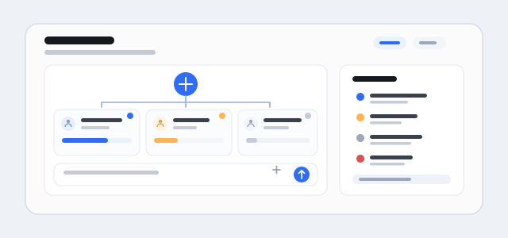

Typical use: turn it on for a project, give the Router a goal, then watch task cards for running, queued and lost work; steer a running Worker, answer its approval, or read its report from the panel. Create topics within an instance for independent chat histories, a shared task pool and schedule management, and optional summary sharing or history recall.

Limits: one machine and one process per data directory; Worker sessions cannot continue across a host restart, so the Router either resumes them or marks them interrupted; without the companion notification plugin there are no system notifications.
