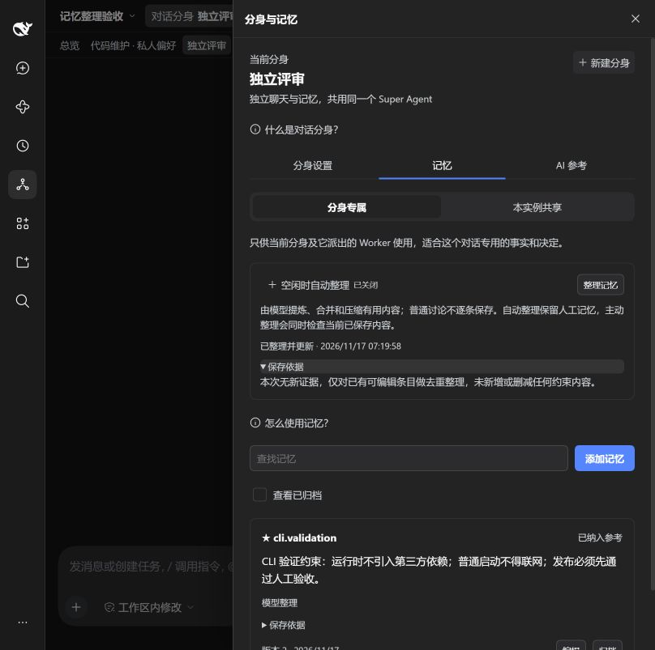

# 记忆更新与上下文选择

## 问题与参考

旧版把记录追加到一个文本块，只注入开头，可能保留旧日期而漏掉后续修订。版本化条目
与完整上下文选择解决了更新和读取问题；实际反馈又表明，写入时机和提炼质量需要独立
处理：活跃讨论中的临时参数容易被提前固化，内容变更后还会占预算、干扰新决定。

2026-11-17 核对的一手资料与取舍如下。不同产品的默认阈值、版本和存储模型不能混用：

| 一手资料 | 可借鉴的机制 | 本项目的取舍 |
| --- | --- | --- |
| [Codex：固定提交的整理模板](https://github.com/openai/codex/blob/c7234c1174b27d9c55199fba0d546dc27d1b0415/codex-rs/memories/write/templates/memories/consolidation_v2.md)与[异步入口](https://github.com/openai/codex/blob/c7234c1174b27d9c55199fba0d546dc27d1b0415/codex-rs/memories/write/src/start.rs) | 后台提取与融合；证据、范围、时间顺序和无变化时不写入；单次选择保留在任务中 | 采用证据支持的融合和空结果，不照搬文件布局、V1/V2 切换或空闲小时数 |
| [Letta：Memory & dreaming](https://docs.letta.com/configuration/memory) | 工作中学习持久信息，也可显式记住；后台复盘，支持额外模型审阅 | 借鉴后台复盘，首版只用一次有界整理调用，不引入常驻整理 Agent 或 MemFS |
| [LangMem：结构化记忆集合](https://langchain-ai.github.io/langmem/guides/extract_semantic_memories/)与[延迟处理](https://langchain-ai.github.io/langmem/guides/delayed_processing/) | LLM 提炼／更新相关事实；活动期间推迟并合并处理，可单次调用或多步管理 | 复用现有条目、版本和作用域；模型负责语义取舍，程序负责延迟、冲突和提交 |
| [Claude Code：持久记忆](https://code.claude.com/docs/en/memory) | 在线维护记忆索引，详细主题按需读取，提醒精简索引 | 保持简洁的自动注入和可编辑事实，不照搬前若干行裁剪或让主对话直接维护文件 |
| [Mem0：Add Memory](https://docs.mem0.ai/core-concepts/memory-operations/add)与[开源组件](https://docs.mem0.ai/open-source/overview) | 用 LLM 从对话提取事实；当前 Add 文档描述追加式存储，并提供标识隔离与检索 | 借鉴 LLM 提取与来源隔离；沿用本项目替换／归档语义，不新增嵌入、向量库或外部服务 |

Codex 资料对应固定的开源提交，不代表所有桌面客户端或账户级记忆。
这些资料支持分工、提炼与按需读取的原则，不证明本项目的预算和空闲时间数值最优。

## 最小实现

仍由实例拥有现有 JSON 记忆和一个 Router Runtime，宿主保存原始聊天。整理直接调用
宿主已配置的模型接口，沿用实例 Worker 模型选择，不创建第二个 Router、执行会话或
最近任务卡片；模型不获得工具、文件系统或其他会话的权限。

### 写入与整理的职责

- 前台显式请求：用户要求记住、更正或撤回时，单独的 LLM 调用结合实际用户消息判断
  意图并精炼内容，再提交版本检查。原有事实写入工具复用这条路径；普通讨论或临时
  方案返回未持久化，保留在工作上下文。不靠关键词清单判断语义；模型返回带依据的
  提案，程序绑定真实用户来源、作用域和版本，模型不能自行扩大权限或共享范围。
  修订已有记录时，整理模型只依据正式旧值与当前用户原话生成新版，不接收主对话重写的
  替换正文，避免草稿引入的额外限制成为二次整理的锚点；首次新增仍可提供不受信任的草稿。
  这减少一条语义漂移路径，不构成对所有改写的语义等价保证。
- 后台整理：有尚未整理的完整消息、相关对话与任务空闲，并经过防抖后，再用 LLM
  比较消息和已有记忆，提取可复用知识、合并重复、压缩表述、更新或归档过时自动记录。
  用户可以从已有记忆页主动整理；无有用新信息时允许零修改。
- 整理输出为有界结构化变更，不直接覆盖整份记忆。程序核对来源标识、所属作用域、
  目标版本、容量和完整文本；任一变更无效时保留原集合。用户编辑、明确要求保存的
  记录受到保护，后台不能随意改写；显式纠正和主动整理有单独入口。
- 前台规则说明改为简短工具契约，语义策略集中在整理调用中；不把每次遇到的例外
  继续追加到主 Router 提示词。LLM 负责判断价值、持久性与融合，确定性代码负责边界。
- 每个实例同时至多一个后台整理任务。新消息、并发编辑或作用域变更使旧快照失效，
  旧结果不覆盖新值；记录上次处理位置及结果，重启后重新比较。失败不阻塞聊天，
  不自动反复重试，不把整理调用自身输出当成新的聊天材料。
- 自动整理默认等待 15 分钟空闲；这是可调整的防抖起点。小场景缩短等待验证触发顺序，
  真实长任务另保留默认等待，验证独立读者空闲后可得到零修改结果，不宣称该时长最优。
  界面可关闭自动整理，并查看状态或主动运行。
- 自动生成仍留在原分身或群中；私人信息不因整理扩大共享范围。实例共享的人工记录
  单独整理，不能把某个私人分身的材料自动提升为实例知识。
- 程序按本次模式给出可编辑集合，自动模式排除人工记录，主动模式允许精简已有人工
  记录。稍后点击整理可以处理先前暂缓写入的讨论；永久性“不记住”要求仍须遵守。
  聊天未加载时主动整理只用现有记忆，不启动会话、不把材料缺失解释成事实失效。
- 单次最多 12 项变更，最多读取最近 400 条原始记录中的 100 条可见消息，完整消息
  合计 48000 字符；超大消息整条省略并标明缺失，不从前缀推断。模型总输入最多
  240000 字符；只读共享参考最多 8000 字符，也只选择完整记录。最近 64 个归档名称
  作为参考，程序仍检查整个集合，防止模型复活未展示的归档项。超预算则保留原值。

### 事实与更新

- 记忆分本主题、实例共享两个作用域；模型不能借此读取其他主题的本地记忆。
- 每条有 ID、稳定名称、完整文本、普通／重点、有效／归档、版本、更新时间与来源主题。
  同名事实在同一作用域中更新，不追加相互冲突的日期或负责人。
- 修改、归档、恢复已有条目必须提供读取到的版本；并发冲突保留现值，要求重读。
  保存相同内容幂等。同一名称的本主题事实覆盖该主题看到的共享事实，并明确标识。
- 归档条目不注入、不出现在默认读取中；归档不会删除聊天。单条保留最近五次旧版本供
  人类核对；若来源聊天存在，可进一步追溯。界面直接编辑没有聊天来源，超过最近五版
  的条目版本不保留；不承诺一个无限历史审计库。
- 新条目正文最多 1200 字符，每作用域最多 128 条有效记录；满后显式报错，归档过时
  事实即可释放有效名额。归档与聊天一样保留，不自动轮转文件；不声称磁盘增长有界。
  旧文本原样迁移为旧记录条目，不按换行猜测语义或截断其限定条件。
- UI/API 的旧 `notes/sharedNotes` 展示字段及文本式 `remember` 调用保留，模型读取改为
  有界条目结果。旧式整块替换只能在空记录或提供正确版本时进行；新界面和模型使用
  条目更新。共享保存仍须用户明确表达共享意图。
- 写入使用同目录临时文件替换，避免中途写入损坏主文件；失败时保留临时文件。
  首次将格式 1 写为格式 2 前保留原始格式 1 副本，旧版本不会直接读取格式 2。

### 主题进展

主题进展保存目标、结果、阻塞、下一步，整体带版本。由当前会话在实质变化时更新，
或由操作者编辑；不额外调用模型生成摘要。每字段最多 240 字符，超长要求重新概括，
不在保存时截断。旧回复摘录仅保留为界面线索，不再自动作为主题状态注入。
状态是会话记录的陈述，不替代任务系统的完成状态或验收证据。

### 上下文预算

- 实例新增 `context.maxChars`，默认 12000，约束插件持久上下文：约定、记忆、主题进展
  及其标记。宿主自身系统提示、聊天、工具结果不属于这个预算，不能声称限制了整个
  模型上下文。使用字符预算保持 provider 无关，不把字符冒充 token。
- 优先级：有效约定 → 重点事实 → 当前主题进展 → 普通事实及相关的其他主题进展 →
  其他主题进展。相关进展与普通事实竞争预算，避免积累大量普通事实后所有进展均被挤出。
  同级使用当前请求／主题的关键词匹配，再按更新时间排序；不做隐藏模型评分。
- 完整条目装入，不裁剪正文；装不下就跳过，仍尝试后续较短条目。保留省略数量、
  重点遗漏警告和查询方法。界面显示实际选中及省略项和原因。
- 重点也有物理容量限制，不能承诺无限保留；出现遗漏必须显式提示，禁止把该上下文
  当成完整规则集。若工作必需的约束不明，应读取详情或报告阻塞。
- 其他主题先按共享设置过滤；“不分享”和隐藏主题不参与排序。最多五个状态，按
  相关性与状态更新时间选取，不让修改主题名称伪装成新进展。
- Worker 使用同一选择逻辑，带本主题／共享事实及适用项目约定，不带其他主题进展。
- 当前问题来自宿主已认领的输入，发送请求前刷新选择；不提前读取队列中的后续请求，
  不把宿主自动生成的时间／上下文消息当作问题或事实来源。
- 约定单独读取和旧版会话继续支持；其渲染也改为完整条目，不截断第一条规则。

### 压缩与读取预算的关系

LLM 整理减少重复和临时材料，保留限定条件与证据索引；它不以“达到预算”作为编造或
截断事实的理由。当前任务的参数与交付状态仍属于任务、项目文件和主题进展。确定性的
注入选择继续保留完整条目及遗漏提示，全文按需读取。两者分别控制存储质量和每轮预算，
不把模型压缩当作权限、期限或正确性的硬性保证。

## 交互

管理抽屉分为“分身设置”“记忆”“AI 参考”；产品界面以“对话分身”解释底层主题：

- 分身设置：名称、带说明的共享选项、协作摘要预览与按需编辑、隐藏／恢复；新建位于顶部。
- 记忆：明确区分本主题和实例共享，逐条新增、修改、重点、归档与恢复；保存处理版本冲突。
- 整理：显示本实例自动整理开关、正在整理／最近结果和保存依据；主动整理后可比较旧版。
- AI 参考：预算用量、选中项、按需项、重点遗漏提示。展示用户能据此判断的内容，
  不要求用户理解系统提示词或内部调用协议。

顶部切换栏默认收起，当前分身始终可识别；任务范围位于近期活动。编排与帮助方式见
[交互设计](ui-design.md)。

以下截图仅含隔离验收数据，展示精简后的完整限制与整理依据：

## 验证与验收

离线验证版本冲突、作用域、旧格式迁移、归档／恢复、同名覆盖、整条选择、来源及
实际序列化长度。构造关键限制位于长句末尾的情况，确保不会变成错误的肯定结论。

真实测试固定 Qoder 的 dfmodel，使用独立实例、可持续恢复的场景脚本：

1. 连续多轮新增事实，穿插普通讨论，累计超过注入预算。
2. 多次修改同一日期、负责人、发布条件，验证只有最新有效值被使用。
3. 撤回一条事实，刷新／重启后仍失效；另一主题读取共享新版，不读取私有事实。
4. 将关键否定条件、旧但重要事实置于普通记录之后，在受限预算下验证保留。
5. 多个主题竞争预算，检查相关旧主题和近期无关主题的选择结果。
6. 在同预算下比较旧版前缀注入与新版完整条目选择，分别报告存储选择正确率和真实
   模型回答正确率，不能以工具调用成功替代回答质量。主会话与新读者会话都参与，
   避免答案仅来自原聊天。

界面验证新增、编辑、切换作用域、冲突处理、归档／恢复、上下文预览，以及窄屏和
深浅色。离线回归、真实场景结果、发现的问题与修正记录在开发文档和兼容记录中。
验收要求关键事实更新、失效、隐私与关键条件保留场景全部通过；任何模型失误必须
如实记录，修正后复测，不能把重复运行后的成功描述为初次成功。
