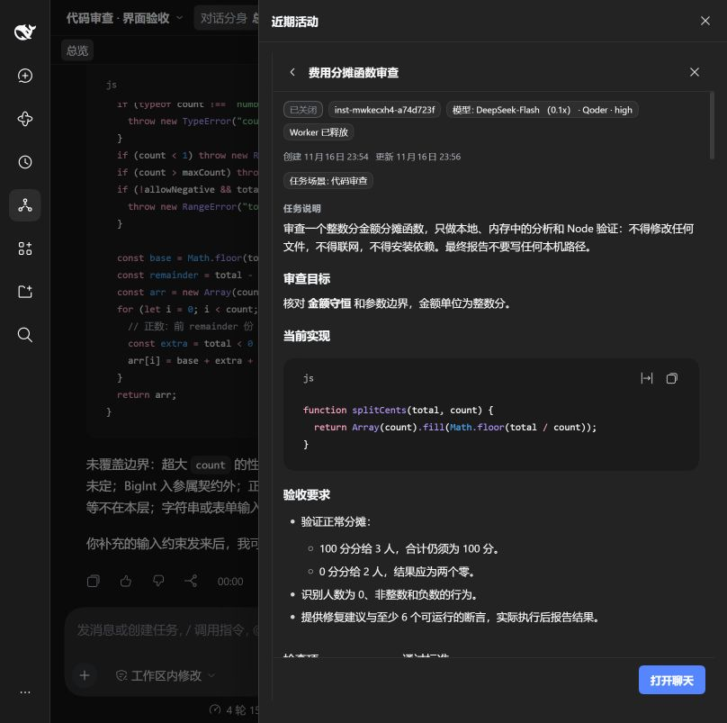
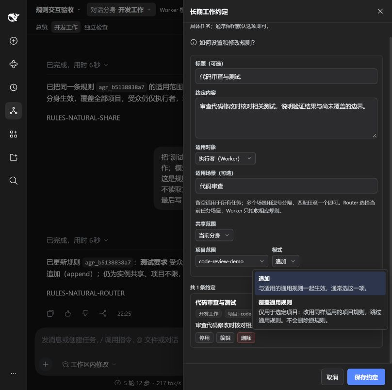

# Super-agent 面板交互设计

## 使用顺序

新用户首先需要开始聊天，再按工作方向分开对话、选择共享范围，最后才需要管理具体
记忆和检查 AI 参考内容。此前把名称、共享、四项进展、创建和隐藏堆在同一长页里，
需要用户先理解内部概念才能使用，也把新建入口推到了最下方。

产品界面使用“对话分身”称呼原来的主题：它是当前 Super Agent 内的独立子会话，
聊天与专属记忆分别保存，任务资源与显式共享的内容属于同一实例。底层 topic ID、
聊天历史、共享契约和权限检查继续沿用；不把它描述为拥有独立权限沙箱的完整实例。

## 编排

- 顶部始终标出当前分身。一个带展开状态的按钮控制切换栏，默认收起，记住本窗口的
  选择；实例名和分身名共用 28px 高、13px 字号、相同圆角与展开反馈的名称控件，
  箭头均为 12px。展开栏采用与工具栏一致的轻按钮和紧凑高度，提供切换、新建和管理入口。
- 创建在管理面板顶部，任何页签都能进入；表单只要求名称，可直接选择带说明的
  共享方式，完成后切换到新分身。名称草稿在创建失败时保留。
- 分身设置先放名称与共享方式。共享菜单每项展示“开放什么／保留什么”；当前选项的
  说明常驻，撤回不能收回已读内容这一边界不藏在帮助里。
- “协作摘要”解释为让其他分身知道正在做什么、卡在哪里的简短说明，由 AI 在有实质
  进展时维护，也可手动纠正。先展示摘要或空状态，按需展开编辑；版本冲突仍保留草稿。
- 记忆区区分分身专属与实例共享，给出直接在聊天中要求记住事实的例子。AI 参考页
  解释本轮会带入哪些信息、遗漏后怎样补读，不要求用户先理解注入协议。
- 任务范围属于“近期活动”，在桌面侧栏和窄屏活动抽屉中都显示；切换范围清空旧详情
  与分页结果，避免把另一范围的任务当作当前结果。标题、数量和列表折叠按钮放在左侧，
  任务范围下拉靠右；两种箭头都是 12px、相同线宽，按钮高 24px，折叠按钮不压缩图标。
  默认加载 6 项任务，按实际 Worker 会话归组；折叠卡片突出正在进行或最近的一轮，
  按需展开已加载的各轮工作，点击后分别查看报告。计数明确区分任务总数与已加载会话数。
  展开入口只写“已加载 N 轮工作”，不重复标注同一 Worker、不附长悬停说明；只有一轮时
  不显示额外底注。沿用关系留在详情中，以轻量的“上一轮任务”按钮返回来源。
  恢复到新会话的任务单独成组，详情可沿“上一轮任务”回看来源；不把相同项目当作相同会话。
  按批加载更多，收起后回到 6 项，缓存中的其他任务仍可再次展开。
- 少用的大范围操作集中在顶部“更多”中，给分身导航和对话空间让位。所有按钮复用
  主题颜色、圆角、悬停和焦点风格；任务范围与菜单项明确使用 12px 字号，避免字体简写
  在样式合并时覆盖字号；不引入新的 UI 库。

设置、协作与侧栏共用主操作、普通按钮、轻按钮和危险操作的基础样式，统一悬停、按下、
键盘焦点和禁用反馈；协作与记忆页签采用相同的选中下划线。反馈仅由插件控件消费，
保留宿主聊天控件自己的外观；减少动态效果的系统设置下关闭过渡。

任务说明与报告复用宿主的 Markdown 渲染器，支持标题、强调、列表、代码块和表格；
侧栏正文 12px、标题 13px，长模型标签省略，时间使用低层级文字。代码保留宿主的复制
和折行操作，宽表格在正文内部滚动。宿主缺少渲染器或单段渲染失败时退回可读文本，
保留完整来源，不以原始 HTML 拼接正文。切换实例、分身或任务范围时关闭旧详情，
失效的异步请求不能重新显示旧内容。

规则编辑区分“共享范围”和“项目范围”，对象及追加／覆盖菜单附带说明；场景以代码
开发、代码审查为例，可留空。上方折叠帮助说明默认值、项目例外和通过聊天编辑规则的
方式。已有规则在所属分身内可修改共享范围，跨分身查看时明确标出归属；重新打开面板
读取最新设置，避免聊天已修改而界面仍显示旧缓存。

自绘菜单不放在原生 `label` 内，避免整行空白激活按钮。原生输入仍使用明确的标签关联。
菜单容器贴合按钮宽度，外部点击只关闭；展开时焦点不滚动父抽屉，菜单内部滚动保持
展开；尺寸计算包含边框与内边距，窄屏保持在视口内。规则列表先显示标题，再用次级
标签交代范围与条件；长标签允许换行，保存失败保留草稿。
窄屏活动抽屉在查看详情时只展示详情页，返回后保留列表分页，避免两列争抢宽度；载入
失败也保留返回入口。

## 协作入口

顶栏的“分身协作”打开独立抽屉，不把协作设置塞回分身切换栏。抽屉分为协作任务、
群聊、角色与权限。标题旁的“如何使用分身协作？”按需展开三步说明：开启接收分身、
直接在聊天中描述分工、用任务看板或群聊跟进，并提供设置入口和共享边界解释。说明放在
页签上方独立滚动，不重建当前表单；Escape 先关闭说明并将焦点返回帮助按钮。

角色与权限先展示全部可用分身及显眼的“开启协作”按钮，标出已开启数量，再展示可选的
主分身设置。没有参与者时主分身选择禁用，并说明需要先开启分身；开启后不自动指定主分身。
职责为可选项，切换开启状态不会丢失尚未保存的职责草稿。只接收协作任务的分身需要开启，
发起对话的分身可保持关闭；已有分身的聊天共享方式不随协作开关改变。

交办表单同时显示接收者及其职责，要求完整的目标与约束；列表标出发起者、当前负责人
与状态，详情显示结果和交接记录。发起失败保留草稿与去重标识，版本冲突要求重读。

群聊先显示固定成员和群协调分身，再显示消息、点名按钮和输入框；占位说明直接解释
“未点名交给协调分身”。普通进展与结果留在群中，不产生全体回复。群内记忆按需展开，
复用既有事实编辑器和版本冲突流程，避免用户再学一套保存规则。内部协作 Session 不作为
通知导航目标，侧栏按已登记 ID 隐藏，不改变用户当前页面。

暂停表示保留队列、暂缓后续投递；取消表示结束一个请求及其子请求。界面分别使用这两个
动词，不把暂停写成“停止所有执行”。遇到预算或宿主恢复失败显示原因，保留记录供检查。

## 视图恢复

原生宿主会恢复当前 Session，却不保存主面板位置；槽热替换还会暂时取消面板选择。
插件在当前标签页的会话存储中只保存“面板／会话”偏好，不保存消息内容。恢复以主面板
重新注册和原生会话目录就绪为条件，仅尝试一次；失败时保留原生页面，不定时重开。
用户主动打开 Session 或其他面板会取消待恢复；带明确目标的通知链接优先。

## 说明与可访问性

频繁操作保持可见，较少使用的编辑项和解释按需展开，参考
[NN/g 的渐进披露原则](https://www.nngroup.com/articles/progressive-disclosure/)。
这是一项基于当前任务流程的设计判断，不当作已经完成用户研究的结论。

切换栏使用按钮、`aria-expanded` 和关联内容区域，支持键盘 Enter／Space，参考
[WAI Disclosure 模式](https://www.w3.org/WAI/ARIA/apg/patterns/disclosure/)。
协作帮助使用带关联区域的展开按钮，启用按钮提供开关状态；有描述的共享选择仍保留明确
选中状态和键盘操作。

## 验证

2026-11-17 UTC，在 DSH 0.2.2-rc.3 的隔离实例与应用内浏览器验证设置菜单、模型选择、
协作页签、任务归组和 Markdown 正文。检查常规窗口、1280×900 桌面侧栏与 390×844
窄屏，以及深浅两种外观；结束后恢复默认窗口尺寸与“跟随系统”。

- 菜单悬停和选中反馈、方向键焦点、Escape 返回焦点、模型选项标签与禁用按钮均检查。
  宿主的焦点颜色可能为透明，插件使用当前主题的强调色保证键盘焦点可见。
- 已有四轮修订场景确认无长展开提示，单轮无底注，上一轮导航实际跳转到来源任务。
- 合成的金额分摊代码审查产生三项真实任务，包含标题、嵌套列表、代码与宽表格；记录
  确认 Router 和 Worker 仅使用 Qoder 的 dfmodel。宽内容不撑开 292px 侧栏或窄屏抽屉。
- 实际切换实例确认旧详情清空；回归覆盖旧请求延迟返回，以及同一任务重新打开时的响应顺序。

完整回归 518 项：Windows 511 通过／7 跳过，WSL2 516 通过／2 跳过，语法检查通过。
环境相关用例按条件跳过。截图仅含合成示例，真实会话、原始日志和证据不入库。

规则编辑的同日验证还覆盖整行标签误开菜单、外部关闭、项目菜单、追加／覆盖说明、
项目清空联动、帮助开合保留草稿和共享范围保存；808×520 与 390×844 菜单保留视口
边距。Qoder 的 dfmodel 五轮自然语言修改确认始终为同一规则 ID，收窄后另一分身不再
获得该规则，重新共享后恢复可见。

2026-11-14 UTC 的既有交互验证：

| 操作 | 结果 |
| --- | --- |
| 展开、收起和刷新 | 桌面顶栏 40px；分身栏展开 32px，收起 0px，当前名称仍可见，刷新后折叠选择恢复 |
| 创建并切换 | 名称重复显示中文提示，名称与共享选择保留；改名后成功，私有共享选择正确保存；窄屏同样可创建 |
| 说明与摘要 | 点击展开概念帮助；共享菜单每项展示说明；新分身显示无需预填摘要，四项手动保存后可读预览正确更新 |
| 记忆 | 新分身可保存专属事实，返回列表显示版本与本轮是否选中；旧有并发冲突保护继续由回归覆盖 |
| 任务范围 | 两个分身分别派出 Qoder 的 dfmodel Worker 并完成；当前分身显示 1 条，全部显示 2 条，桌面侧栏与活动抽屉均可选择，全部列表标注来源 |
| 键盘与布局 | 共享菜单支持方向键与 Escape；任务范围选择后焦点保留；深浅色和 390×844 窄屏检查通过，窄屏未见横向溢出 |
| 近期活动标题 | 折叠图标紧邻标题及计数，范围下拉靠右；两个图标实测均为 12×12px、相同线宽；折叠后范围选择保留 |
| 字体与视图恢复 | 任务范围和“更多”项实测 12px；冷刷新恢复可用聊天，主动打开 Session 后刷新仍由原生页面接管；真实客户端热更新恢复面板 |
| 名称控件与任务数量 | 两个名称控件实测均高 28px、字号 13px、圆角 7px、箭头 12px；分页回归验证 6 条起步、尾页完整及收起后再次展开缓存 |
| 协作入门 | 标题旁展开帮助，Escape 先关帮助并返回焦点，设置入口切换到角色与权限；初始 0/3 时主分身禁用并解释原因，开启及保存职责后按需选择主分身，未自动指定 |
| 协作窄屏 | 390×844 页面与抽屉均无横向溢出，启用按钮完整可见，帮助可独立滚动且不丢失下方设置 |

真实页面验证发现文档捕获阶段会先关闭管理面板，导致一个 Escape 同时关闭菜单与
面板。现由外层捕获监听让出内部弹层，先关菜单、后关面板；回归也按真实顺序模拟。
新建失败聚焦名称，任务范围更新保留筛选控件，不通过卸载重建丢失键盘焦点。

协作补充验证覆盖建群、点名写作分身、群内事实保存、并发版本冲突、载入新值、归档与
恢复，以及取消既有事实编辑。已有事实编辑器和列表条目必须使用不同 React 标识，
否则取消后可能残留旧编辑框。桌面消息区实测高 378px；390px 窄屏没有横向溢出，
长群聊内部滚动，输入区不随消息无限增长。
